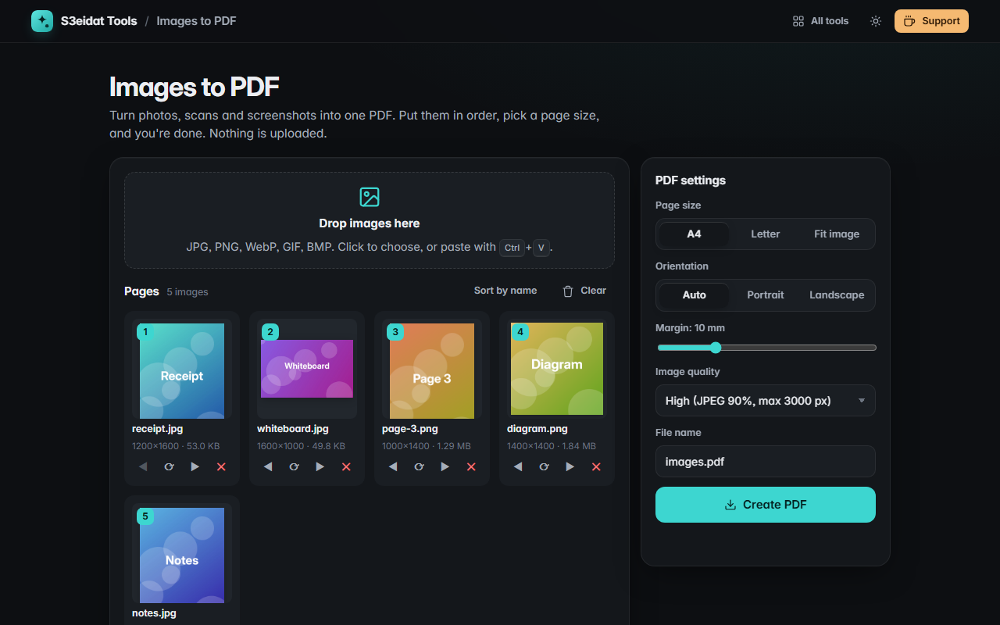

# Images to PDF

> Turn photos and scans into one PDF. Free, private, and it runs entirely in your browser.

### ▶ [Open Images to PDF](https://s3eidat.github.io/images-to-pdf/)



## Features

- Drop, choose or **paste** JPG, PNG, WebP, GIF and BMP images (anything your browser can open)
- **Reorder** by dragging or with the arrows, sort by name, **rotate** sideways photos, remove any image
- **Page size**: A4, Letter, or fit each page to its image
- **Orientation**: auto (per image), portrait or landscape
- **Margin** from 0 to 40 mm; images are centered and scaled to fit
- **Quality**: keep the original JPEG/PNG data untouched, or compress to high / medium / small
- Phone photos come out the right way up (EXIF orientation is respected)
- Transparent PNGs stay transparent in "Original" mode

## Privacy

Your images never leave your device: they are decoded and placed into the PDF by JavaScript in this tab. There is no server,
no account, no analytics. The page ships with a strict Content-Security-Policy (`connect-src 'self'`), so the browser itself
blocks any attempt to send data anywhere. Only your settings are remembered in this browser.

## Run it yourself

It's plain HTML, CSS and JavaScript with no build step:

```bash
git clone https://github.com/s3eidat/images-to-pdf
cd images-to-pdf
python -m http.server 8000
```

Then open http://localhost:8000.

## Credits

PDF writing by [pdf-lib](https://pdf-lib.js.org/) (Andrew Dillon, MIT), shipped in `lib/`.

## Support

If this saved you time, **[buy me a coffee ☕](https://s3eidat.github.io/coffee/)**. It keeps every tool free.

---

Part of **[S3eidat Tools](https://s3eidat.github.io/)**: 100+ free, private tools that run in your browser. MIT licensed.
